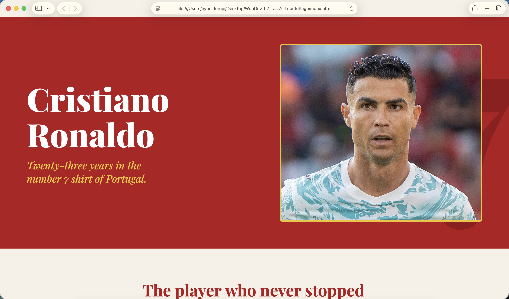

# Tribute Page: Cristiano Ronaldo

**Oasis Infobyte Web Development & Designing Internship — Level 2, Task 2**

A responsive tribute page honouring Cristiano Ronaldo's 23-year international career with Portugal, built with HTML5 and CSS3 (no JavaScript).

## Checklist
- Title with the subject's name and a one-line tagline
- Prominent image (`images/ronaldo.jpg`, from Wikimedia Commons)
- Four-paragraph original biography
- Timeline of key moments, as an ordered list of styled cards
- Distinct quote block
- Four background colours: red, paper, green and dark red
- Two font styles: Playfair Display (serif headings) and Source Sans 3 (sans-serif body)
- Responsive layout (CSS Grid, `clamp()` sizing, one mobile breakpoint)

## Run it
Open `index.html` in a browser.

## Sources
Retirement details: CBS News, AP, Gulf News (November 2026). Career facts paraphrased from public sources.

Photo: Bryan Berlin, [CC BY-SA 4.0](https://creativecommons.org/licenses/by-sa/4.0/), via Wikimedia Commons.

## Screenshot

