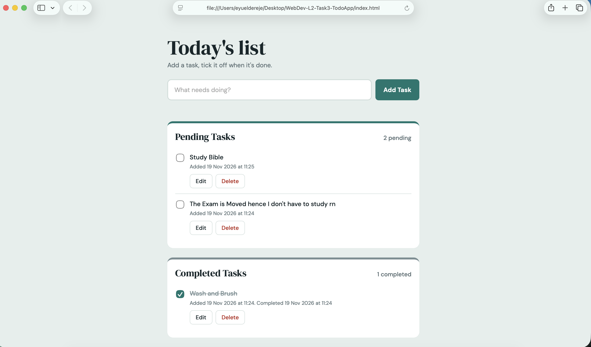

# To-Do App

**Oasis Infobyte Web Development & Designing Internship: Level 2, Task 3**

A task manager built with HTML5, CSS3 and vanilla JavaScript. Tasks are split into Pending and Completed lists and saved in the browser, so they survive a page refresh.

## Features
- Add tasks with the input box and **Add Task** button (or press Enter)
- New tasks appear straight away in **Pending Tasks**
- Tick a task to move it to **Completed Tasks**; untick it to move it back
- **Edit** a task inline: Enter or Save to keep the change, Escape or Cancel to discard it
- **Delete** a task permanently from either list
- Live counters above each list: "X pending" and "Y completed"
- Friendly empty-state messages when a list has no tasks
- Bonus: a timestamp for when each task was added and completed
- Bonus: persistence with `localStorage`
- Empty input is rejected with a clear message
- Task text is inserted with `textContent`, so typed HTML is never run
- Keyboard accessible, with visible focus and a responsive layout

## Run it
Open `index.html` in any modern browser.

## Files
| File | Purpose |
| --- | --- |
| `index.html` | Page structure |
| `style.css` | Styling |
| `script.js` | State, rendering, events and storage |

## How it works
Tasks live in an array of objects (`id`, `text`, `done`, `createdAt`, `completedAt`). Every change updates the array, saves it to `localStorage`, and re-renders both lists from that array. One click handler per list (event delegation) handles edit, save, cancel and delete.

## Screenshot

